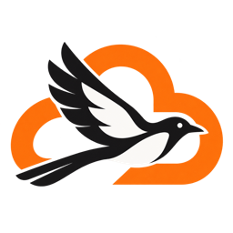

# Cloudflare AI Gateway for Magpie



在 Magpie 登录界面配置 Cloudflare Account、Gateway、BYOK alias 和 Token。插件自动发现供应商和模型，上游 API Key 始终保存在 Cloudflare，所有请求强制禁止 Unified Billing 回退。

## 安装与登录

```bash
magpie plugin add /path/to/magpie-cloudflare-gateway
magpie plugin login cloudflare-gateway-byok
```

在 Magpie 应用中添加本地插件文件夹后，点击登录或“添加另一个账号”，按界面填写：

| 字段 | 内容 |
| --- | --- |
| Cloudflare Account ID | 32 位十六进制账户 ID |
| AI Gateway ID | Cloudflare 中的 Gateway 名称 |
| BYOK key alias | 可选，留空使用 default |
| Cloudflare AI Gateway token | 具有 AI Gateway Run 和 Read 权限的 Token 原文，不带 Bearer 前缀 |

不需要创建或导入 options.json。Account ID、Gateway ID、alias 与 Token 按账号保存在 Magpie 的登录信息中。每个账号独立选择 Gateway 和 alias；同一 Account、Gateway、alias 再次登录会更新这个账号。

Cloudflare 侧需要开启 Authenticated Gateway，并在 Provider Keys 中保存上游 Key。运行插件不需要 AI Gateway Edit 或 Secrets Store 权限。Read/Run 的资源范围是 Account，不能仅限定单个 Gateway。

Agent 中的模型名为 `cloudflare-gateway-byok/<provider>/<model>`，例如 `cloudflare-gateway-byok/deepseek/deepseek-flash`。

## 自动发现

1. 查询当前账号对应 Gateway 的 provider_configs，筛选所选 alias 下的供应商。
2. 经 Gateway 调用供应商原生模型列表，模型 ID 来自真实列表。
3. 以 models.dev 补充能力、价格和容量，厂商列表明确提供的容量优先。

没有 Read 权限时会记录诊断，并通过强制 BYOK 的原生模型列表做只读探测。只有成功返回的模型或当前账号最近一次成功的列表会被展示，不会把公共目录直接当成账号可用模型。

未知能力默认关闭；未知容量为满足宿主接口暂设为 8192/1024，并在模型发现元数据中标记 unknown。模型目录不等于每个模型都已通过实际推理验证。价格缺失时宿主可能显示零，不代表免费。

## 内置供应商

| 标识 | Cloudflare slug | 默认协议 |
| --- | --- | --- |
| openai | openai | Responses |
| anthropic | anthropic | Messages |
| deepseek | deepseek | Chat Completions |
| google | google-ai-studio | Chat Completions |
| xai | grok | Chat Completions |
| groq | groq | Chat Completions |
| mistral | mistral | Chat Completions |
| openrouter | openrouter | Chat Completions |

当前真实推理验收覆盖 DeepSeek，其余适配使用模拟响应测试。模型名称过滤含部分启发式规则，特殊模型可能被过滤。

## 可选高级选项

插件全局选项只接受 providers、adapters、overrides，默认是空对象。普通使用无需填写。

```json
{
  "providers": ["deepseek"],
  "overrides": {
    "deepseek/deepseek-flash": { "output": 4096 }
  }
}
```

- providers：限制自动发现范围。
- overrides：按自动模型完整 ID 覆盖 name、context、output、tools、images、reasoning。
- adapters：为 Cloudflare 支持的供应商增加或修改路径适配；不能填写任意外部地址。

例如以下结构需要替换为真实供应商的 slug 和路径：

```json
{
  "adapters": {
    "example": {
      "slug": "example-provider",
      "protocol": "chat",
      "basePath": "/v1",
      "modelsPath": "/v1/models",
      "format": "openai",
      "catalog": "example"
    }
  }
}
```

protocol 支持 chat、responses、messages；列表 format 支持 openai、anthropic、google。路径相对当前账号 Gateway 的供应商 slug，禁止外部 URL、路径穿越和查询参数，分页由插件负责。catalog 可省略。适配声明不负责转换不兼容的上游协议。

## 凭证与请求

- Token 不写入插件选项或环境文件，插件不读取 .env。
- 推理与原生模型发现请求均强制携带 cf-aig-no-wholesale，没有开启统一计费回退的开关。
- 发出前移除供应商认证头，再应用当前账号的 Gateway Token 和 alias。
- 仅允许该账号 Gateway 下的已适配端点、已发现模型；禁止跟随重定向。
- Gateway Token 失效与上游 Key 失效分别处理，避免上游 401 导致整个 Gateway 登录失效。
- 请求取消、流式输出及上游错误体透传，不做额外推理重试。

## 缓存

账号的 Account、Gateway、alias、Token 均参与隔离。模型列表在宿主内缓存 10 分钟，合并并发刷新；过期后推理请求先按旧列表放行、后台刷新，模型列表接口仍等待新结果。临时失败（含 provider_configs）后 30 秒重试并保留该账号最近成功的模型。成功返回空列表、明确缺少 Key 或凭证拒绝时，移除相应模型。

公开的 models.dev 元数据由所有账号共用一份，缓存 6 小时，可在网络失败时使用旧缓存。磁盘缓存写在 Magpie 传入的数据目录（实测为 ~/.config/magpie），不保存 Token 或账号模型清单。

## 开发与验证

```bash
npm test
bun test
```

测试覆盖登录表单与身份校验、Gateway/alias/Token 隔离、模型发现、权限降级、分页、缓存与后台刷新、Key 移除、错误分类、扩展适配、请求目标校验、流式和取消。修改源码后需在 Magpie 触发插件重载。

完整网关联调不能设置 MAGPIE_NO_ACCOUNTS=1，该设置也会禁用插件供应商账号。

## 2026-10-29 验收

- 代码审查修复前 Node.js 与 Bun 各运行 34 项测试，全部通过；修复后 Node.js 运行 39 项全部通过，Bun 未复跑（本机当前未安装）。
- 实际 Magpie 界面已逐步验证 Account ID、Gateway ID、可选 alias 和 Token 输入。
- 当前账号已按新表单保存网关字段，全局选项为空，原 Token 保持不变。
- Magpie 模型测试：deepseek-flash 1318 ms，deepseek-v4-pro 730 ms，均成功。
- npm 打包预检包含 10 个文件（含图标），不包含本地配置或凭证。

## 参考

- [Magpie 插件接口](https://usemagpie.ai/docs/zh/plugins)
- [Cloudflare BYOK](https://developers.cloudflare.com/ai-gateway/configuration/bring-your-own-keys/)
- [Provider Configs API](https://developers.cloudflare.com/api/resources/ai_gateway/subresources/provider_configs/methods/list/)
- [禁止统一计费回退](https://developers.cloudflare.com/ai-gateway/features/unified-billing/#prevent-unified-billing-fallback-for-byok-third-party-providers)

项目的 private 标志用于防止意外 npm 发布。
